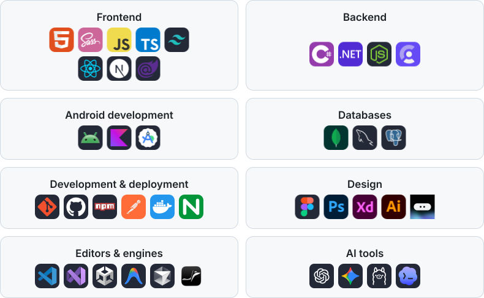

  

<h3 align="center">
  <samp>&gt; Hello there! I’m 
  <a href="https://github.com/byZeet">Cosmin Robert</a></samp>
</h3>

  <samp>
    「 Full-stack developer from <b>Spain</b> 」 
    「 I build web apps for everyday life. 」
  </samp>

<h2>Skills</h2>

  <picture>
    <source media="(max-width: 620px)" srcset="./assets/skills-compact.svg">
    
  </picture>

