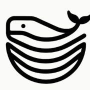

  <picture>
    <source srcset="./assets/intro.svg">
    
  </picture>

<h3><samp>Full-stack developer from Spain</samp></h3>

<samp>I build mobile and desktop apps with <b>.NET MAUI</b>, web apps with <b>React and Next.js</b>, and the <b>C# APIs</b> that power them.</samp>

 

<h2>Skills</h2>

<picture><source srcset="./assets/frontend-headings.svg"></picture> 
<picture><source srcset="./assets/space.svg"></picture><picture><source srcset="./assets/space.svg"></picture><picture><source srcset="./assets/space.svg"></picture><picture><source srcset="./assets/space.svg"></picture><picture><source srcset="./assets/space.svg"></picture><picture><source srcset="./assets/space.svg"></picture><picture><source srcset="./assets/space.svg"></picture><picture><source srcset="./assets/space.svg"></picture> 
<picture><source srcset="./assets/space.svg"></picture><picture><source srcset="./assets/space.svg"></picture><picture><source srcset="./assets/space.svg"></picture><picture><source srcset="./assets/space.svg"></picture><picture><source srcset="./assets/space.svg"></picture><picture><source srcset="./assets/space.svg"></picture><picture><source srcset="./assets/space.svg"></picture><picture><source srcset="./assets/space.svg"></picture>

<picture><source srcset="./assets/android-headings.svg"></picture> 
<picture><source srcset="./assets/space.svg"></picture><picture><source srcset="./assets/space.svg"></picture><picture><source srcset="./assets/space.svg"></picture><picture><source srcset="./assets/space.svg"></picture><picture><source srcset="./assets/space.svg"></picture><picture><source srcset="./assets/space.svg"></picture><picture><source srcset="./assets/space.svg"></picture><picture><source srcset="./assets/space.svg"></picture>

<picture><source srcset="./assets/dev-headings.svg"></picture> 
<picture><source srcset="./assets/space.svg"></picture><picture><source srcset="./assets/space.svg"></picture><picture><source srcset="./assets/space.svg"></picture><picture><source srcset="./assets/space.svg"></picture><picture><source srcset="./assets/space.svg"></picture><picture><source srcset="./assets/space.svg"></picture><picture><source srcset="./assets/space.svg"></picture><picture><source srcset="./assets/space.svg"></picture><picture><source srcset="./assets/space.svg"></picture> 
<picture><source srcset="./assets/space.svg"></picture><picture><source srcset="./assets/space.svg"></picture><picture><source srcset="./assets/space.svg"></picture><picture><source srcset="./assets/space.svg"></picture><picture><source srcset="./assets/space.svg"></picture><picture><source srcset="./assets/space.svg"></picture><picture><source srcset="./assets/space.svg"></picture><picture><source srcset="./assets/space.svg"></picture><picture><source srcset="./assets/space.svg"></picture>

<picture><source srcset="./assets/editors-headings.svg"></picture> 
<picture><source srcset="./assets/space.svg"></picture><picture><source srcset="./assets/space.svg"></picture><picture><source srcset="./assets/space.svg"></picture><picture><source srcset="./assets/space.svg"></picture><picture><source srcset="./assets/space.svg"></picture><picture><source srcset="./assets/space.svg"></picture><picture><source srcset="./assets/space.svg"></picture><picture><source srcset="./assets/space.svg"></picture><picture><source srcset="./assets/space.svg"></picture><picture><source srcset="./assets/space.svg"></picture><picture><source srcset="./assets/space.svg"></picture><picture><source srcset="./assets/space.svg"></picture>

